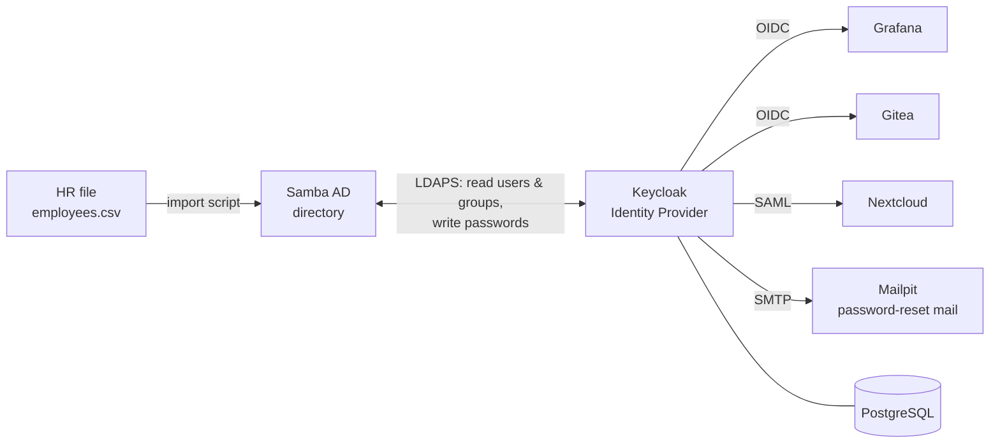

# Greenfield IAM Lab

**A hands-on Identity & Access Management platform for a fictional 50-person company: built, secured, debugged and documented end to end.**

Directory - SSO (OIDC & SAML) - MFA - Least-privilege delegation - Decision records - ISO 27001 / NIS2 mapping

---

## The story

Greenfield Logistics (50 employees: Sales, Finance, HR, IT) had every classic identity problem: a password per app, ex-employees still able to log in, nobody knowing who has access to what, no MFA and no logs.

This lab builds the fix step by step, the way a real IAM team would: **one central identity per person, one login for every app, access driven by role, and evidence that it works.**

All data is fake. No real names, emails or passwords.

---

## Architecture (current)



- **Samba AD** (Ubuntu VM) is the source of truth: users, groups, passwords.
- **Keycloak** checks identities and issues signed tokens. Apps never see passwords.
- **Apps** trust Keycloak and turn group membership into roles.

---

## Progress

| Phase | Topic | Status |
|---|---|---|
| 0 | Lab setup, fake HR data | ✅ Done |
| 1 | Directory: Samba AD, OUs, groups, scripted user import, password policy | ✅ Done |
| 2 | SSO: Keycloak + AD federation, Grafana & Gitea (OIDC), Nextcloud (SAML), password reset | ✅ Done |
| 3 | MFA: TOTP for everyone, passkeys for admins, brute-force protection, recovery runbook | ✅ Done |
| 4–5 | Own app (FastAPI): token validation, roles, OPA policies, Separation of Duties | ⏳ Planned |
| 6 | Identity governance (midPoint): joiner / mover / leaver, access reviews | ⏳ Planned |
| 7–9 | Secrets & PAM (OpenBao), logging & detection (Grafana/Loki), everything as code | ⏳ Planned |
| 10–13 | PKI & mTLS, customer identity (Auth0), attack my own system, audit evidence | ⏳ Planned |

---

## What's built, in job-ad terms

| Capability | How it's done here |
|---|---|
| **Active Directory / LDAP** | Samba AD domain `greenfield.lab`; OUs per department; groups named `GRP-<Dept/Org/Role/App>-<Name>`; Python import over LDAPS |
| **SSO / Federation** | Keycloak federates AD; Grafana and Gitea via **OIDC**, Nextcloud via **SAML** |
| **RBAC** | AD groups → token `groups` claim → app roles (e.g. `GRP-App-Gitea-Admin` → admin, everyone else → normal user) |
| **Least privilege** | Keycloak uses a dedicated service account; it may reset passwords **only** in Sales, Finance and HR, and **not** for IT admins, which closes a privilege-escalation path |
| **Secure OIDC setup** | Confidential clients, PKCE, exact redirect URIs, Standard flow only; one documented exception (Gitea, no PKCE support) with a compensating control |
| **MFA** | TOTP enforced through a custom Keycloak login flow (in progress) |
| **Access control** | App logins limited to active staff (`GRP-Org-All-Staff`), so leavers lose access automatically |
| **Break-glass** | Local emergency admin per app, outside SSO |
| **Certificates** | Keycloak verifies the domain controller's CA instead of disabling certificate checks |
| **Infrastructure as code** | Whole stack in `docker-compose.yml`, versions pinned, secrets only in `.env` |

---


## Repository layout

```
├── data/employees.csv       # fake HR data (source of truth)
├── directory/               # domain controller build guide, OU/group script, user import
├── keycloak/truststore/     # public CA certificate Keycloak trusts (never private keys)
├── docs/                    # decisions, explanations, compliance
├── docker-compose.yml       # Keycloak, PostgreSQL, Grafana, Gitea, Nextcloud, Mailpit
└── .env.example             # names of required settings; real values stay in .env (not in Git)
```

---

## Run it

1. Build the domain controller VM: follow [directory/README.md](directory/README.md).
2. Create OUs and groups: `sudo bash directory/create_ous_groups.sh` (on the VM).
3. Import users: `python directory/import_users.py` (from WSL).
4. `cp .env.example .env` and fill in the passwords.
5. `docker compose up -d`
6. Configure Keycloak (realm, AD federation, clients). This is manual today; a realm export and OpenTofu follow in Phase 9.
7. Open Grafana `localhost:3000`, Gitea `localhost:3001`, Keycloak `localhost:8080` and sign in with an AD user.

---

